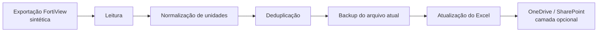

# FortiView Excel Automation

[](https://github.com/CelsoKaiqueSil/fortiview-excel-automation/actions/workflows/ci.yml)
[](pyproject.toml)
[](src/fortiview_excel/pipeline.py)
[](scripts/run_windows.ps1)
[](.env.example)
[](data/traffic_sample.csv)

Automação demonstrativa para transformar uma rotina semanal de atualização de
planilhas em um processo agendado, padronizado e protegido por backup.

## Fluxo



## Recursos

- conversão de B, KB, MB, GB e TB para bytes;
- preservação do histórico e prevenção de duplicidades;
- backup com data e hora antes de alterar um arquivo existente;
- páginas `Dados` e `Resumo`;
- cabeçalhos, filtros, congelamento de painel e larguras configuradas;
- execução pelo Windows Task Scheduler ou cron;
- configuração externa por variáveis de ambiente.

## Executar

```bash
python -m venv .venv
python -m pip install -e ".[dev]"
fortiview-excel --input data/traffic_sample.csv --output output/traffic_weekly.xlsx
pytest -q
```

No Windows, o script [run_windows.ps1](scripts/run_windows.ps1) pode ser associado
ao Agendador de Tarefas. Em Linux, use [run_linux.sh](scripts/run_linux.sh).

## Segurança

A edição pública não realiza login em firewall, não contém IPs reais e não envia
arquivos a um tenant. A integração com Microsoft Graph é apresentada como fronteira
arquitetural e deve utilizar uma identidade de aplicativo com o menor privilégio
possível.

## Contexto profissional

O estudo representa uma automação recorrente de tráfego enviado e recebido,
mantendo o padrão visual da planilha operacional e reduzindo cópias manuais.
