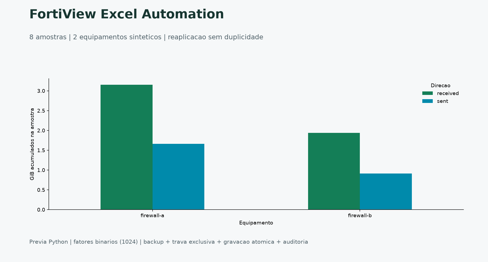
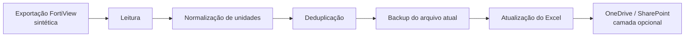

# FortiView Excel Automation


[](https://github.com/CelsoKaiqueSil/fortiview-excel-automation/actions/workflows/ci.yml)

**Uma rotina recorrente, uma entrega consistente.** Automação de planilhas de
tráfego com normalização, prevenção de duplicidades, backup e auditoria.

[Baixar Excel de exemplo](docs/examples/traffic_weekly.xlsx) ·
[Executar](#executar) ·
[Agendamento Windows](scripts/run_windows.ps1) ·
[Regras de atualização](#concorrencia-e-dados-corrigidos)

## Resultado em uma leitura



<sub>Prévia Python: 8 amostras de 2 equipamentos fictícios. Conversão binária com fator 1024; o resumo usa GiB, não GB decimal.</sub>

A edição pública funciona offline e não envia arquivos para OneDrive ou SharePoint.

## Fluxo



## Recursos

- conversão de B, KB, MB, GB e TB para bytes;
- preservação do histórico e prevenção de duplicidades;
- backup com data e hora antes de alterar um arquivo existente;
- páginas `Dados` e `Resumo`;
- cabeçalhos, filtros, congelamento de painel e larguras configuradas;
- execução pelo Windows Task Scheduler ou cron;
- configuração externa por variáveis de ambiente.

## Executar

```bash
python -m venv .venv
source .venv/bin/activate  # Linux/macOS
python -m pip install -e ".[dev]"
fortiview-excel --input data/traffic_sample.csv --output output/traffic_weekly.xlsx
pytest -q
```

No Windows PowerShell: `.\.venv\Scripts\Activate.ps1` em lugar de `source`.
Sem ativacao: `.\.venv\Scripts\python.exe -m fortiview_excel.pipeline`.
Use o mesmo Python com `-m pytest`; nao e necessario alterar politicas globais.

Resultado esperado na primeira execucao: `inserted=8`; na segunda, `inserted=0` e
backup distinto. `python scripts/validate_exports.py` confere os arquivos.
`python scripts/preview.py` regenera a imagem dos totais.

## Concorrencia e dados corrigidos

Uma segunda execucao falha enquanto existir a trava `.xlsx.lock`. Nao apague uma
trava sem confirmar que o processo anterior terminou. Nao ha remocao automatica
de trava por idade. Salve e feche o Excel antes de atualizar no Windows.

A identidade e `collected_at + device + interface + direction`. Conflitos dentro
da mesma entrada bloqueiam a atualizacao; dados corrigidos numa execucao posterior
substituem o valor e preservam o anterior na auditoria e no backup. Nao rode duas
copias em pastas sincronizadas esperando que a trava local funcione como trava distribuida.

No Windows, o script [run_windows.ps1](scripts/run_windows.ps1) pode ser associado
ao Agendador de Tarefas. Em Linux, use [run_linux.sh](scripts/run_linux.sh).

## Segurança

A edição pública não realiza login em firewall, não contém IPs reais e não envia
arquivos a um tenant. A integração com Microsoft Graph é apresentada como fronteira
arquitetural e deve utilizar uma identidade de aplicativo com o menor privilégio
possível.

## Contexto profissional

O estudo representa uma automação recorrente de tráfego enviado e recebido,
mantendo o padrão visual da planilha operacional e reduzindo cópias manuais.
